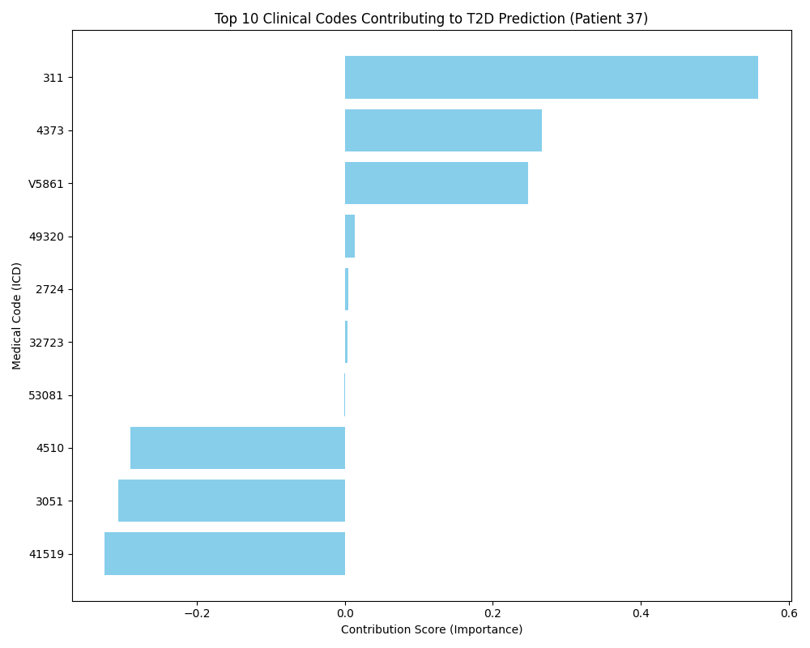

# Interpretable Type 2 Diabetes Prediction

PyTorch sequence models for exploring diabetes prediction from electronic health records, with an LSTM baseline and a dual-attention model inspired by RETAIN.

**Research prototype · Python · PyTorch · Electronic health records · Interpretable ML**

## Problem & Motivation

Patient records contain diagnosis histories of different lengths. A useful modeling workflow needs to turn these histories into model inputs and make the factors behind a prediction inspectable.

This project explores that workflow using MIMIC-IV diagnosis records. It combines data preprocessing, sequence classification, and an example attention-based visualization. The current implementation is a learning and research prototype; it does not establish clinical effectiveness or performance on unseen patients.

## Approach

1. **Prepare records:** Load patient, admission, and diagnosis tables; filter patients using `anchor_age >= 18`.
2. **Construct labels and histories:** Identify recorded diagnoses using the implemented `250` and `E11` code-prefix rules. For positive cases, retain history more than 365 days before the first matching admission. For negative cases, use available diagnosis history. Exclude cases with no retained history.
3. **Encode inputs:** Map diagnosis codes to integer IDs and pad variable-length sequences for batching.
4. **Train models:** Compare an LSTM classifier with a two-GRU attention model named `RETAIN` in the code. Both use learned code embeddings and binary cross-entropy training.
5. **Inspect an example:** Select a correctly classified positive case from the supplied dataset and plot attention-weighted embedding scores for its diagnosis codes.

The implementation includes the preprocessing, model definitions, training loop, data loader, and visualization script. It uses PyTorch's recurrent layers rather than implementing recurrent networks from scratch.

### Implementation scope

Inputs are flat diagnosis-code sequences, not grouped visits. The preprocessing script does not explicitly sort records by admission time, and the attention model does not reverse its input sequence. The current model should therefore be understood as a RETAIN-inspired implementation, not a verified reproduction of the original architecture.

The code-prefix labeling rule, code-system handling, and different history windows for positive and negative cases require review before treating this as a validated future-onset prediction task.

## Technologies

| Technology | Role |
|---|---|
| Python 3.10+ | Preprocessing, training, and interpretation scripts |
| PyTorch | Embeddings, LSTM/GRU layers, attention, and optimization |
| pandas and NumPy | Record processing and numerical operations |
| scikit-learn | Training ROC-AUC calculation |
| Matplotlib | Example interpretation plots |
| tqdm | Preprocessing and training progress |
| MIMIC-IV | Source patient, admission, and diagnosis records |

Python 3.10 or newer is required by the type-annotation syntax in `src/models.py`. The repository does not currently include a pinned dependency environment.

## How to Run

### 1. Set up the project

```bash
git clone https://github.com/pashaeimehran/interpretable-type-2-diabetes-prediction.git
cd interpretable-type-2-diabetes-prediction
python -m venv .venv
```

Activate the environment on Linux/macOS:

```bash
source .venv/bin/activate
```

Or on Windows PowerShell:

```powershell
.\.venv\Scripts\Activate.ps1
```

Install the packages used by the scripts:

```bash
python -m pip install torch pandas numpy scikit-learn matplotlib tqdm
```

These are dependency setup instructions, not a pinned reproduction of the original training environment. GPU use depends on your PyTorch installation; the training script selects CUDA when available and otherwise uses the CPU.

### 2. Prepare the data

Obtain MIMIC-IV through its official access process. The original project documentation identifies version 2.2. Patient data and trained model weights are not included in this repository.

Place the required files at:

```text
data/raw/hosp/patients.csv.gz
data/raw/hosp/admissions.csv.gz
data/raw/hosp/diagnoses_icd.csv.gz
```

Keep patient data, generated datasets, and checkpoints out of public commits. Run all following commands from the repository root.

### 3. Preprocess and train

```bash
python src/preprocess.py --mimic_dir ./data/raw --output_dir ./data/processed
python src/train.py --data_path ./data/processed/processed_t2d_data.pkl --model LSTM --output_dir ./models --epochs 20
python src/train.py --data_path ./data/processed/processed_t2d_data.pkl --model RETAIN --output_dir ./models --epochs 20
```

Expected outputs are `data/processed/processed_t2d_data.pkl`, `models/LSTM_final.pth`, and `models/RETAIN_final.pth`. Training duration depends on the retained cohort and hardware.

### 4. Generate an example visualization

```bash
python src/interpret.py --data_path ./data/processed/processed_t2d_data.pkl --model_path ./models/RETAIN_final.pth --output_dir ./results
```

The script writes `results/interpretation_patient_<index>.png` if it finds a positive case that the model classifies above the 0.5 threshold. Otherwise, it reports that no suitable case was found.

## Results & Limitations

### Previously reported training results

The original project README reported the following values after 20 epochs:

| Model name in the code | Reported training ROC-AUC |
|---|---:|
| LSTM | 0.9931 |
| RETAIN | 0.9987 |

These are training metrics, not held-out validation or test results. The current training script accumulates predictions during optimization and computes an epoch-level training AUC. It does not evaluate a separate validation or test set. Original run logs and checkpoints are not bundled, so these historical values cannot be independently checked from the repository alone.

### Example interpretation artifact



The repository contains this example image. The interpretation script sums attention-weighted embedding components but does not include the final classifier weights in those scores. Treat the visualization as an exploratory view of internal model quantities, not a verified decomposition of the prediction or evidence of causal clinical risk factors.

### Current limitations

- No patient-level train/validation/test evaluation is implemented.
- Chronological ordering, label definitions, and observation windows need review.
- The flat-sequence attention implementation differs from visit-based reverse-time modeling.
- Padding is not explicitly masked in attention or handled with sequence lengths in the LSTM's final-state selection.
- Clinical utility and generalization have not been established by the supplied results.

## Repository Guide

| File | Purpose |
|---|---|
| [`src/preprocess.py`](src/preprocess.py) | Record loading, cohort construction, labeling, and encoding |
| [`src/models.py`](src/models.py) | LSTM and RETAIN-inspired model definitions |
| [`src/utils.py`](src/utils.py) | Dataset, padding, and data loading |
| [`src/train.py`](src/train.py) | Training and checkpoint saving |
| [`src/interpret.py`](src/interpret.py) | Example attention-based visualization |
| [`results/interpretation_plot.png`](results/interpretation_plot.png) | Existing example image |

## License

Code is provided under the [MIT License](LICENSE). Dataset access and use are governed separately by the data provider's terms.
